# dexterous-hand-urdf

Dexterous robot hand URDF models collected by 주식회사 왓츠랩 (WHATs LAB Corp), based on [dexsuite/dex-urdf](https://github.com/dexsuite/dex-urdf) (MIT).

Interactive viewer: https://whats-lab.github.io/whatslab-sdk/

| Robot Model | Official Website | URDF Source | License | Preview |
| :-- | :-- | :-- | :-- | :-- |
| [Tesollo DG-5F-S](robots/hands/tesollo_dg5f_s) | [Tesollo](https://www.tesollo.com) | [tesollo_model@2ce9aca](https://github.com/tesollodelto/tesollo_model/tree/2ce9aca) | BSD-3-Clause | 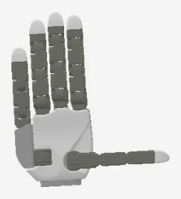 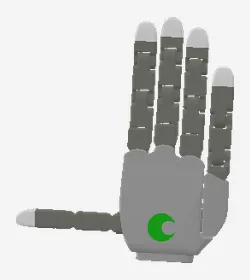 |
| [Tesollo DG-5F](robots/hands/tesollo_dg5f) | [Tesollo](https://www.tesollo.com/products/grippers/dg-5f-m) | [dg5f_ros2@0cb45ae](https://github.com/tesollodelto/dg5f_ros2/tree/0cb45ae) | BSD-3-Clause | 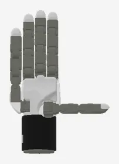 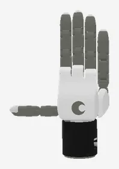 |
| [Allegro Hand V5 (4 finger)](robots/hands/allegro_v5_4f) | [Wonik Robotics](https://www.allegrohand.com) | [allegro_hand_ros2_v5@80bd4a8](https://github.com/Wonikrobotics-git/allegro_hand_ros2_v5/tree/80bd4a8) | BSD-2-Clause | 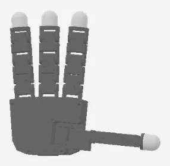 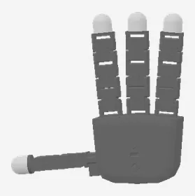 |
| [Allegro Hand V6](robots/hands/allegro_v6) | [Wonik Robotics](https://www.allegrohand.com) | [allegro_hand_ros2_v6_v@fd7072d](https://github.com/Wonikrobotics-git/allegro_hand_ros2_v6_v/tree/fd7072d) | MIT | 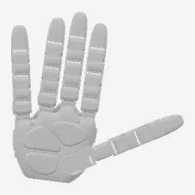 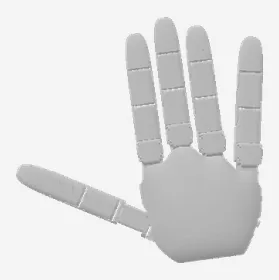 |
| [Allegro Hand V5 Sense](robots/hands/allegro_v5_sense) | [Wonik Robotics](https://www.allegrohand.com) | [allegro_hand_ros2_V5_Sense@92bfca9](https://github.com/Wonikrobotics-git/allegro_hand_ros2_V5_Sense/tree/92bfca9) | MIT | 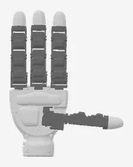 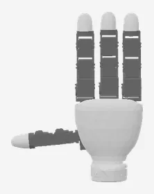 |
| [ROBOTIS HX5-D20](robots/hands/robotis_hx5_d20) | [ROBOTIS](https://docs.robotis.com/docs/systems/hx5_d20/introduction) | [robotis_hand@fe8c244](https://github.com/ROBOTIS-GIT/robotis_hand/tree/fe8c244c6429e9a5ffecb4f6e430216c323f534c) | Apache-2.0 | 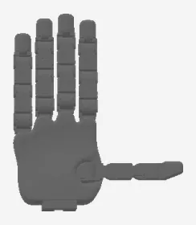 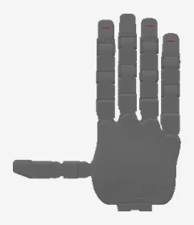 |
| [ROBROS IGRIS-C hand](robots/hands/igris_c_hand) | [ROBROS](https://www.robros.co.kr) | [igris_c_description_public@8e7d9bc](https://github.com/robrosinc/igris_c_description_public/tree/8e7d9bc) | BSD-3-Clause | 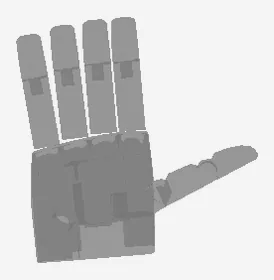 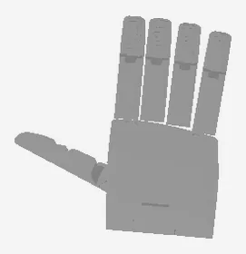 |
| [AIDIN Hand Gen2](robots/hands/aidin_hand2) | [AIDIN ROBOTICS](https://www.aidinrobotics.co.kr) | [aidin-hand2-ros2@835108b](https://github.com/aidinrobotics/aidin-hand2-ros2/tree/835108b/aidin_hand2_description) | Apache-2.0 | 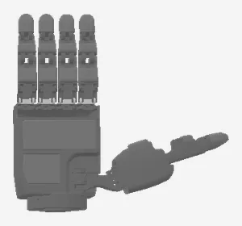 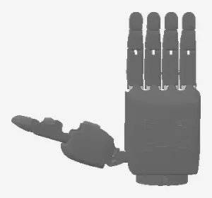 |
| [LEAP Hand V2 Advanced](robots/hands/leap_hand_v2_adv) | [LEAP Hand](http://leaphand.com) | [LEAP_Hand_V2_Adv_API@a093619](https://github.com/leap-hand/LEAP_Hand_V2_Adv_API/tree/a093619) | Apache-2.0 | 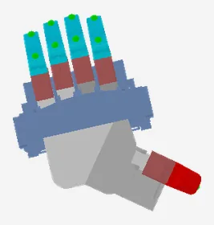 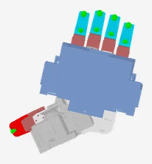 |
| [LinkerHand L6](robots/hands/linkerhand_l6) | [LinkerBot](https://www.linkerbot.cn) | [linkerhand-urdf@49f2602](https://github.com/linker-bot/linkerhand-urdf/tree/49f2602) | Apache-2.0 | 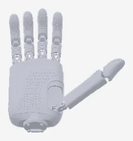 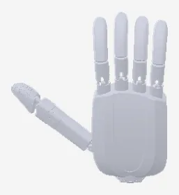 |
| [LinkerHand O6](robots/hands/linkerhand_o6) | [LinkerBot](https://www.linkerbot.cn) | [linkerhand-urdf@49f2602](https://github.com/linker-bot/linkerhand-urdf/tree/49f2602) | Apache-2.0 | 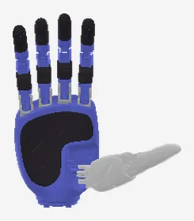 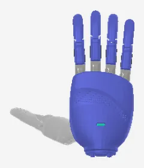 |
| [LinkerHand L20](robots/hands/linkerhand_l20) | [LinkerBot](https://www.linkerbot.cn) | [linkerhand-urdf@49f2602](https://github.com/linker-bot/linkerhand-urdf/tree/49f2602) | Apache-2.0 | 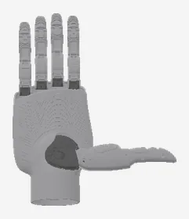 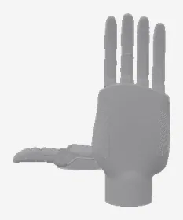 |
| [LinkerHand L20 Lite](robots/hands/linkerhand_l20lite) | [LinkerBot](https://www.linkerbot.cn) | [linkerhand-urdf@49f2602](https://github.com/linker-bot/linkerhand-urdf/tree/49f2602) | Apache-2.0 | 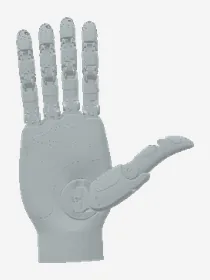 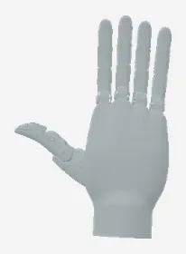 |
| [LinkerHand O7](robots/hands/linkerhand_o7) | [LinkerBot](https://www.linkerbot.cn) | [linkerhand-urdf@49f2602](https://github.com/linker-bot/linkerhand-urdf/tree/49f2602) | Apache-2.0 | 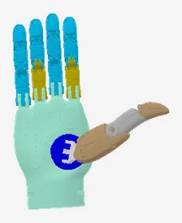 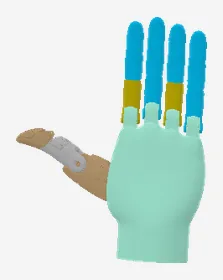 |
| [LinkerHand L25](robots/hands/linkerhand_l25) | [LinkerBot](https://www.linkerbot.cn) | [linkerhand-urdf@49f2602](https://github.com/linker-bot/linkerhand-urdf/tree/49f2602) | Apache-2.0 | 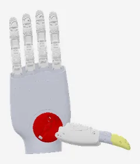 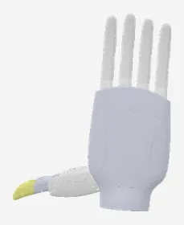 |
| [LinkerHand O20](robots/hands/linkerhand_o20) | [LinkerBot](https://www.linkerbot.cn) | [linkerhand-urdf@49f2602](https://github.com/linker-bot/linkerhand-urdf/tree/49f2602) | Apache-2.0 | 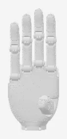 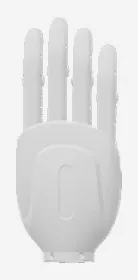 |
| [LinkerHand L30](robots/hands/linkerhand_l30) | [LinkerBot](https://www.linkerbot.cn) | [linkerhand-urdf@49f2602](https://github.com/linker-bot/linkerhand-urdf/tree/49f2602) | Apache-2.0 | 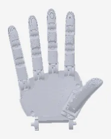 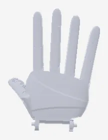 |
| [LinkerHand O30i](robots/hands/linkerhand_o30) | [LinkerBot](https://www.linkerbot.cn) | [linkerhand-urdf@49f2602](https://github.com/linker-bot/linkerhand-urdf/tree/49f2602) | Apache-2.0 | 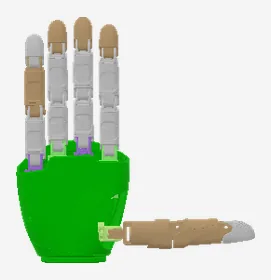 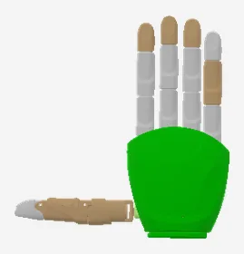 |
| [LinkerHand T12](robots/hands/linkerhand_t12) | [LinkerBot](https://www.linkerbot.cn) | [linkerhand-urdf@49f2602](https://github.com/linker-bot/linkerhand-urdf/tree/49f2602) | Apache-2.0 | 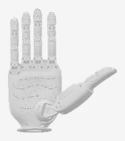 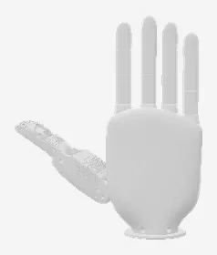 |
| [BrainCo Revo2](robots/hands/brainco_revo2) | [BrainCo](https://www.brainco.tech) | [revo2_description@92cc697](https://github.com/BrainCoTech/revo2_description/tree/92cc697) | Apache-2.0 | 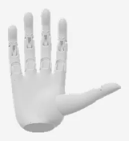 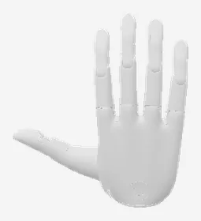 |
| [BrainCo Revo3](robots/hands/brainco_revo3) | [BrainCo](https://www.brainco.tech) | [brainco_revo3_ros2@2fa9db4](https://github.com/BrainCoTech/brainco_revo3_ros2/tree/2fa9db4) | Apache-2.0 | 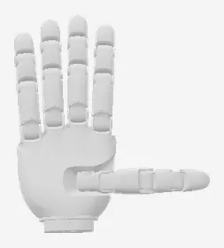 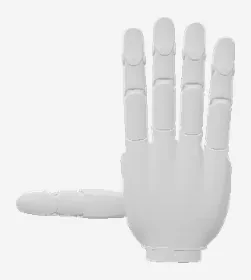 |
| [DexRobot DexHand021](robots/hands/dexrobot_dexhand021) | [DexRobot](https://www.dex-robot.com/en) | [dexrobot_urdf@eb5ecde](https://github.com/DexRobot/dexrobot_urdf/tree/eb5ecde) | Apache-2.0 | 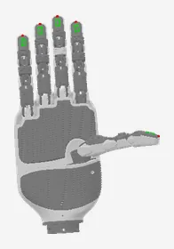 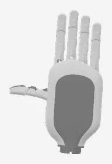 |
| [Sharpa Wave](robots/hands/sharpa_wave) | [Sharpa](https://www.sharpa.com) | [sharpa-urdf-usd-xml@d323b37](https://github.com/sharpa-robotics/sharpa-urdf-usd-xml/tree/d323b37) | Apache-2.0 | 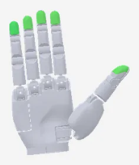 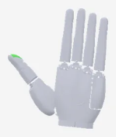 |
| [Wuji Hand](robots/hands/wuji_hand) | [Wuji Technology](https://wuji.tech) | [wuji-description@ffeb47f](https://github.com/wuji-technology/wuji-description/tree/ffeb47f/hand/body) | MIT | 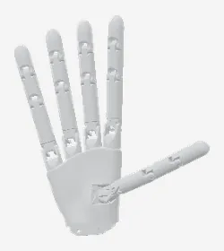 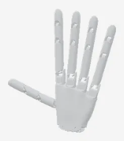 |
| [Wuji Hand 2 (2.1)](robots/hands/wuji_hand2) | [Wuji Technology](https://wuji.tech) | [wuji-description@ffeb47f](https://github.com/wuji-technology/wuji-description/tree/ffeb47f) | MIT | 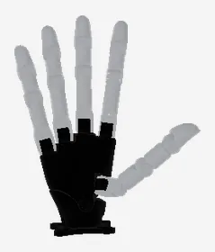 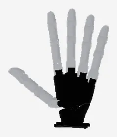 |
| [DexHand (TheRobotStudio)](robots/hands/dexhand_trs) | [DexHand](https://www.dexhand.org/) | [dexhand_description@211b0ea](https://github.com/iotdesignshop/dexhand_description/tree/211b0ea) | CC BY-NC-SA 4.0 |   |
| [ORCA Hand v1](robots/hands/orca_hand_v1) | [ORCA](https://orcahand.com) | [orcahand_description@64ff756 v1/](https://github.com/orcahand/orcahand_description/tree/64ff756/v1) | MIT |   |
| [ORCA Hand v2](robots/hands/orca_hand_v2) | [ORCA](https://orcahand.com) | [orcahand_description@64ff756 v2/](https://github.com/orcahand/orcahand_description/tree/64ff756/v2) | MIT |   |
| [Allegro Hand](robots/hands/allegro_hand) | [Wonik Robotics](https://www.wonikrobotics.com/research-robot-hand) | [allegro_hand_ros@296ef6b](https://github.com/simlabrobotics/allegro_hand_ros/tree/296ef6b/allegro_hand_description) | BSD |   |
| [Shadow Hand](robots/hands/shadow_hand) | [Shadow Robot Company](https://www.shadowrobot.com/) | [sr_common@172c3d9](https://github.com/shadow-robot/sr_common/tree/172c3d9/sr_description) | BSD-3-Clause |   |
| [SCHUNK SVH Hand](robots/hands/schunk_hand) | [SCHUNK](https://schunk.com/us/en) | [schunk_svh_ros_driver@c271044](https://github.com/SCHUNK-GmbH-Co-KG/schunk_svh_ros_driver/tree/c271044/schunk_svh_description) | GPL-3.0 |   |
| [Ability Hand](robots/hands/ability_hand) | [PSYONIC](https://www.psyonic.io/) | [ability-hand-api@26ca079](https://github.com/psyonicinc/ability-hand-api/tree/26ca079/URDF) | MIT |   |
| [LEAP Hand](robots/hands/leap_hand) | [LEAP Hand](http://leaphand.com) | [LEAP_Hand_Sim@150bc3d](https://github.com/leap-hand/LEAP_Hand_Sim/tree/150bc3d/assets/leap_hand) | MIT |   |
| [Inspire Hand](robots/hands/inspire_hand) | [Inspire-Robots](https://www.inspire-robots.com/) | [Inspire STEP download](https://en.inspire-robots.com/download) (official CAD; no official URDF) | None |   |
| [Inspire RH56DFTP (Unitree G1 model)](robots/hands/inspire_rh56dftp_unitree) | [Inspire-Robots](https://www.inspire-robots.com) | [unitree_ros@157ff95](https://github.com/unitreerobotics/unitree_ros/tree/157ff95) | BSD-3-Clause |   |
| [Unitree Dex5-1](robots/hands/unitree_dex5_1) | [Unitree](https://www.unitree.com) | [unitree_ros@157ff95](https://github.com/unitreerobotics/unitree_ros/tree/157ff95) | BSD-3-Clause |   |
| [Unitree Dex5-S](robots/hands/unitree_dex5_s) | [Unitree](https://www.unitree.com) | [unitree_ros@157ff95](https://github.com/unitreerobotics/unitree_ros/tree/157ff95) | BSD-3-Clause |   |
| [Unitree Dex2-5](robots/hands/unitree_dex2_5) | [Unitree](https://www.unitree.com) | [unitree_ros@157ff95](https://github.com/unitreerobotics/unitree_ros/tree/157ff95) | BSD-3-Clause |   |
| [Fourier Hand 6-DoF](robots/hands/fourier_hand_6dof) | [Fourier](https://www.fftai.com) | [Wiki-GRx-Models@7d96c75](https://github.com/FFTAI/Wiki-GRx-Models/tree/7d96c75) | GPL-3.0 |   |
| [RobotEra XHAND1 (STAR1 model)](robots/hands/robotera_xhand1_star1) | [RobotEra](https://www.robotera.com) | [models@e8660e6](https://github.com/roboterax/models/tree/e8660e6) | BSD-3-Clause |   |
| [RobotEra XHAND1 Pro U](robots/hands/robotera_xhand1_pro_u) | [RobotEra](https://www.robotera.com) | [xhand1-pro-u@d9c8dce](https://github.com/roboterax/xhand1-pro-u/tree/d9c8dce) | MIT |   |
| [AgiBot OmniHand 2025](robots/hands/agibot_omnihand_2025) | [AgiBot](https://www.agibot.com) | [agilink_omnihand_description@ddd053c](https://github.com/AgibotTech/agilink_omnihand_description/tree/ddd053c) | Apache-2.0 |   |
| [Rysen Apex Hand](robots/hands/rysen_apex_hand) | [Rysen Robotics](https://www.rysenbot.com/) | [rysen-description@7c9fb7d](https://github.com/RysenRobotics/rysen-description/tree/7c9fb7d) | Apache-2.0 |   |

Per-hand changes are listed in each folder's `PATCHES.txt`.

Meshes are not stored in this repository. Each hand folder has a `meshes.json` that lists the original upstream mesh files (repository, commit, path, sha256, size) referenced by its URDFs. The URDFs alone are enough for kinematics; for visual and collision geometry, download the meshes once into the user cache (`$XDG_CACHE_HOME` or `~/.cache/dexhand_description/<version>/<hand>/`):

```bash
dexhand-fetch --list
dexhand-fetch leap_hand tesollo_dg5f_s
dexhand-fetch --all
```

```python
import dexhand_description

path = dexhand_description.hand_dir("leap_hand")
```

`hand_dir` returns the cached hand folder (URDFs with the meshes at their relative paths) or `None` if a download or sha256 check failed.

